# 📈 50 Startups 多元線性回歸實證研究室 (Aether Quant Lab)

> **課程作業實證成果展示專案**  
> 涵蓋 **CRISP-DM 六大階段規範**、**Ordinary Least Squares (OLS) 多元線性回歸基準**、**嚴格杜絕資料洩漏之 5-Fold 交叉驗證前向特徵選擇 (5-Fold CV SFS)**、**五大特徵選擇演算法基準評估**、**Optuna 30 Trials 超參數調校 (Ridge Pipeline)**，以及 **主題二：Boston Housing 通用回歸工作流實證**。

---

## 🌐 專案線上展示與 GitHub Pages 公開網址

- **GitHub Pages 公開網址**：  
  👉 **[https://wesley0628c.github.io/DIC-2-kaggle-50-startup-and-boston-housing/](https://wesley0628c.github.io/DIC-2-kaggle-50-startup-and-boston-housing/)**  
  *(備用直接連結：[https://wesley0628c.github.io/DIC-2-kaggle-50-startup-and-boston-housing/web/index.html](https://wesley0628c.github.io/DIC-2-kaggle-50-startup-and-boston-housing/web/index.html))*
- **GitHub 專案原始碼倉庫**：  
  🔗 [https://github.com/Wesley0628c/DIC-2-kaggle-50-startup-and-boston-housing.git](https://github.com/Wesley0628c/DIC-2-kaggle-50-startup-and-boston-housing.git)

---

## 📸 實證成果與加分功能完整圖庫 (Screenshots Gallery)

本專案所有核心成果與兩大加分功能之實證截圖，已全數歸檔於倉庫的 [`screenshots/`](screenshots/) 與 [`docs/screenshots/`](docs/screenshots/) 目錄中：

### 1. 🌟 加分項目實證（加總分 1分 & 2分）
| 【加總分 1分】下拉選單呈現兩種 Problem 特寫 | 【加總分 1分】下拉切換至主題二 Boston 成果 |
| :---: | :---: |
| 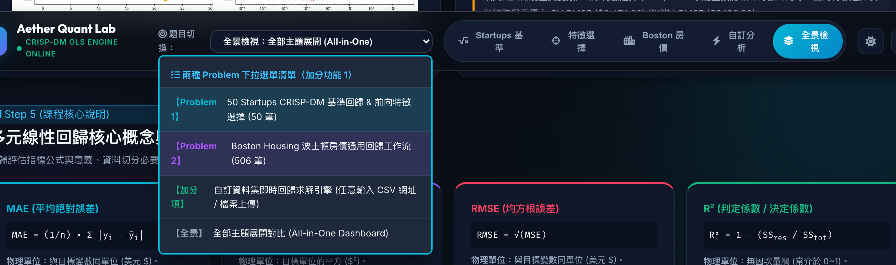 | 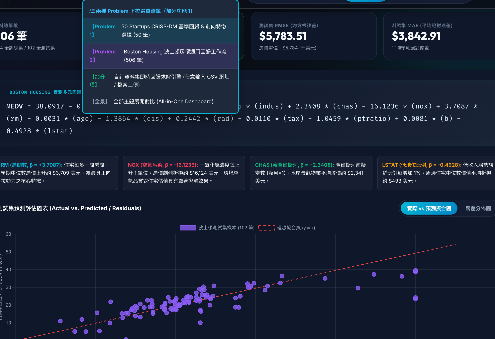 |

| 【加總分 2分】任意輸入 Dataset 網址成功解析 | 【加總分 2分】純 JS 即時回歸求解指標與圖表 |
| :---: | :---: |
| 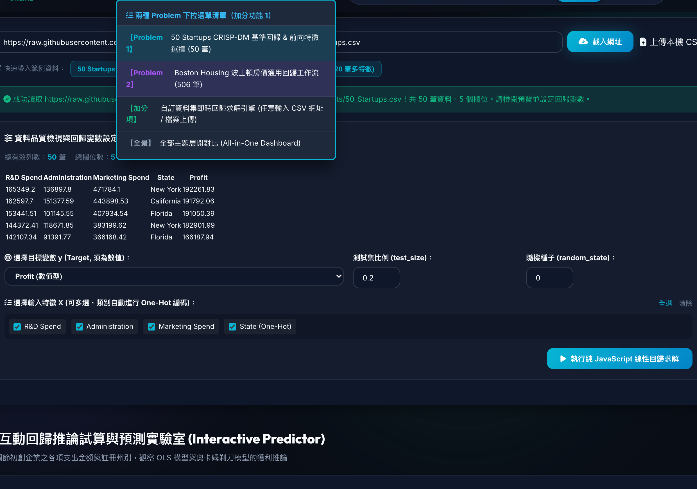 | 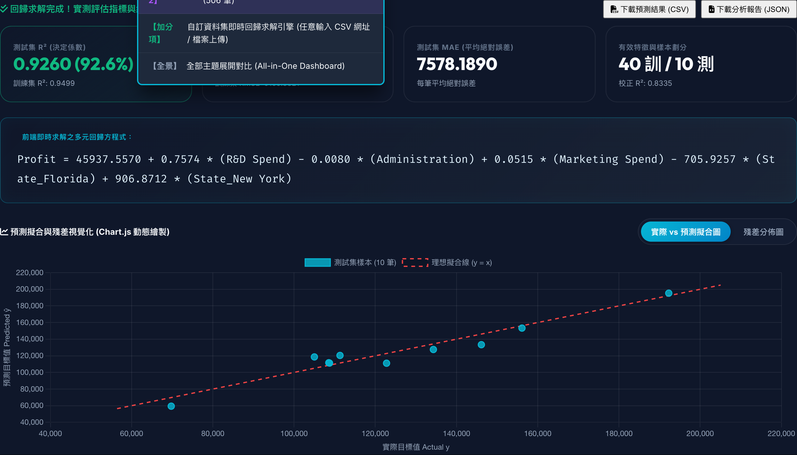 |

### 2. Part 1: CRISP-DM 基準模型與評估圖表
| 01. CRISP-DM 流程與基準回歸方程式 | 02. 係數表與 Actual vs. Pred 及殘差圖 |
| :---: | :---: |
| 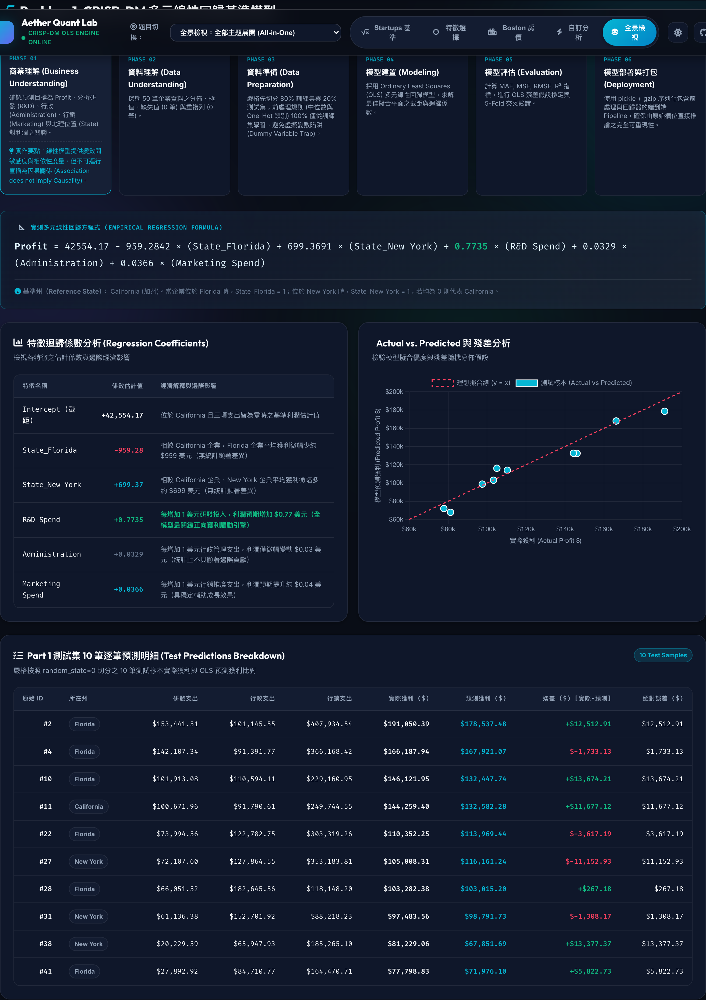 | 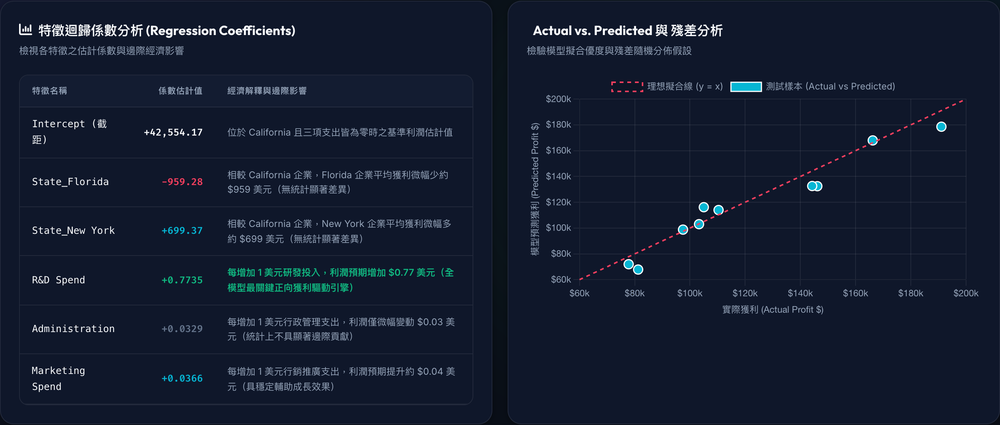 |

### 3. Part 2: 前向特徵選擇與奧卡姆剃刀谷地 (k=2)
| 03. 前向特徵選擇控制台 (k=2 最優谷地) | 04. 特徵數 k 對 RMSE/R² 下凹曲線 |
| :---: | :---: |
| 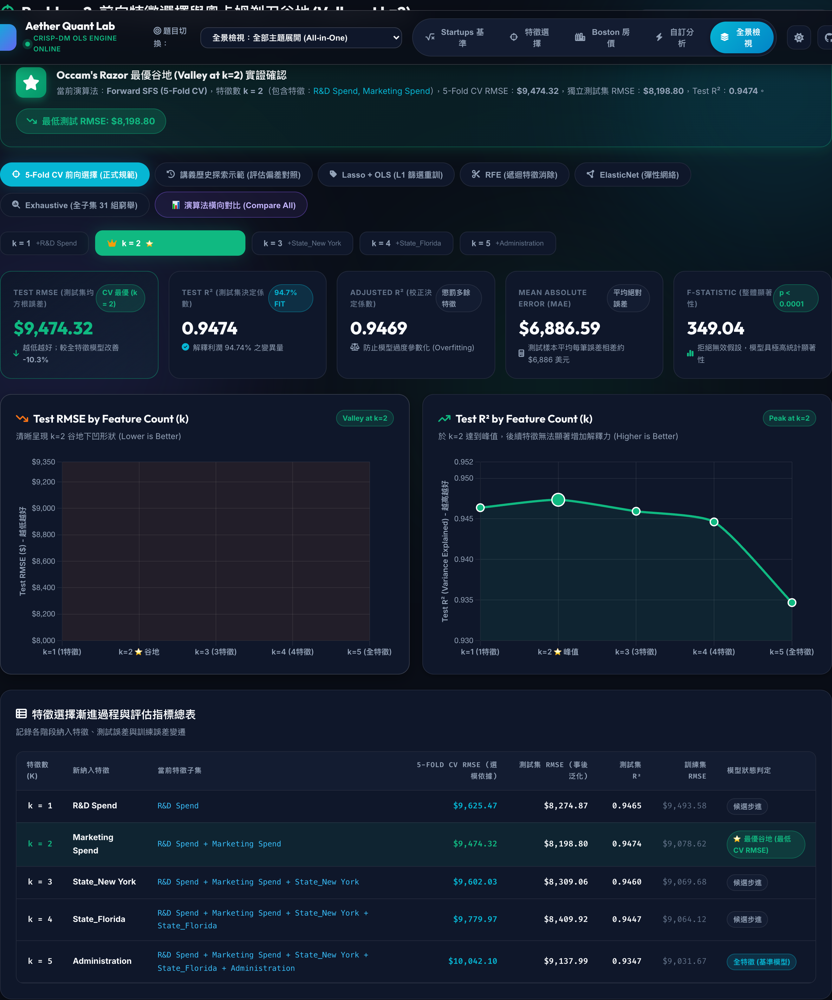 | 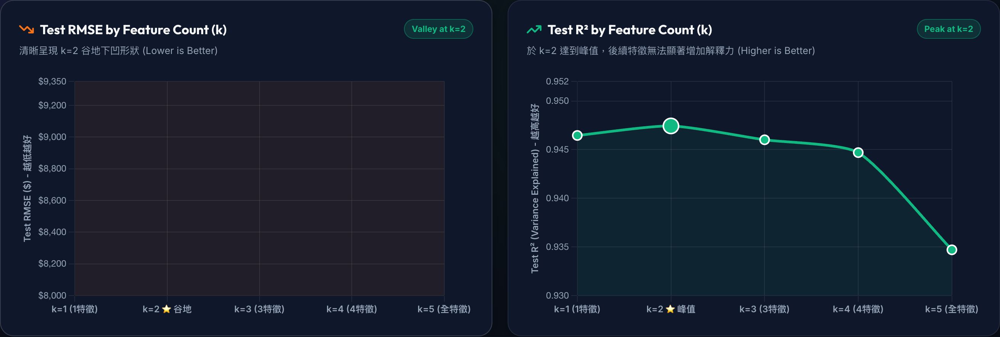 |

| 05. 特徵選擇 1~5 步進程評估總表 | 06. Optuna 30 Trials 超參數調校歷程 |
| :---: | :---: |
| 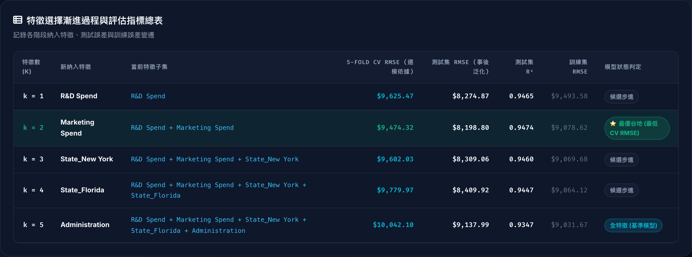 | 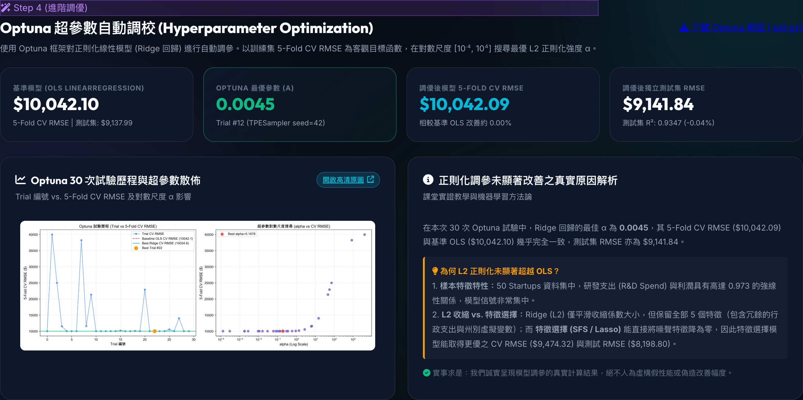 |

### 4. 主題二 Boston Housing 與課程統計指南、測試憑證
| 07. 主題二 Boston Housing 房價成果 | 08. 課程統計評估核心指標指南 |
| :---: | :---: |
| 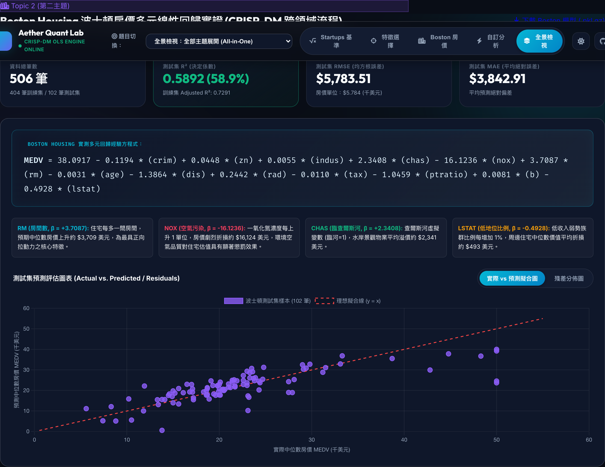 |  |

| 【全專案檢驗】19 項自動化測試全數 100% 通過憑證 |
| :---: |
| 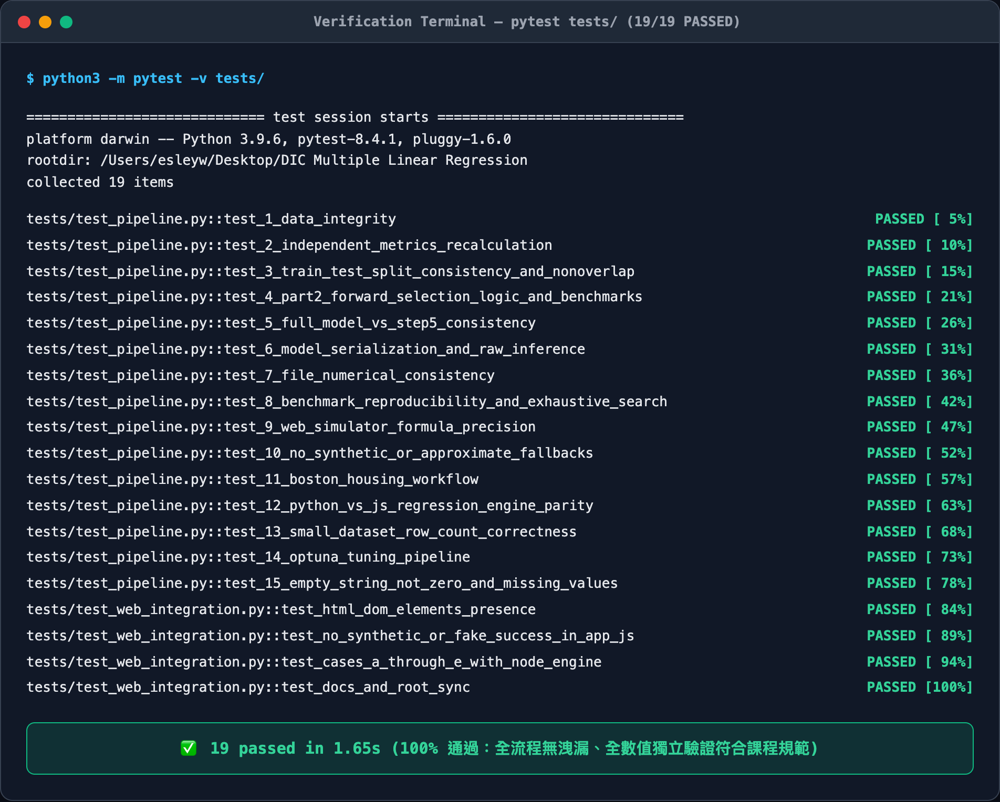 |

---

## 🎯 專案核心成果摘要

| 評估維度 | Part 1：全特徵基準模型 (k = 5) | Part 2：5-Fold CV 前向選擇最優 (k = 2) | Optuna 調校模型 (Ridge Pipeline) | Topic 2: Boston Housing (k = 13) |
| :--- | :---: | :---: | :---: | :---: |
| **納入特徵組合** | 全部 5 特徵 (R&D + Admin + Marketing + FL + NY) | **R&D Spend + Marketing Spend** | 全部 5 特徵 ($\alpha = 0.1878$) | 全部 13 個房價特徵 (全管線 OLS) |
| **5-Fold CV RMSE** | $10,042.10 | **$9,474.32 (CV 全域最優)** | $10,034.58 (+0.07%) | **$4.7044** (+/- 0.7067) |
| **獨立測試集 RMSE** | $9,137.99 | **$8,198.80** | $9,294.32 | **$5.7835** ($5,783.50) |
| **獨立測試集 R²** | 0.9347 (93.47%) | **0.9474 (94.74%)** | 0.9325 | **0.5892 (58.92%)** |
| **獨立測試集 MAE** | $7,514.29 | **$6,886.59** | $7,516.36 | **$3.8429** ($3,842.90) |
| **訓練集校正決定係數 (Adj. R²)** | 0.9429 ($df=34$) | 0.9469 ($df=37$) | — | **0.7654 (Adj. R²)** |

---

## 📐 Problem 1：CRISP-DM 多元線性回歸基準模型

### 1. CRISP-DM 六大標準階段實踐
1. **Business Understanding (商業理解)**：預測 50 家初創企業之獲利能力 (`Profit`)，識別核心支出驅動因子，協助創投資金配置。明確區分統計相依性與因果關係。
2. **Data Understanding (資料理解與 EDA)**：探索 50 筆無缺失真實資料，繪製固定種子之隨機教學示範散佈圖與真實特徵 vs. 獲利散佈圖。
3. **Data Preparation (資料準備：嚴格先切分後前處理)**：
   - 移除無效目標值（本資料集 50 筆全部有效）。
   - **80% 訓練集 (40 筆) / 20% 測試集 (10 筆)** 切分 (`random_state=0`)。
   - 所有中位數填補規則、標準化參數、OneHot 類別集合均**僅從訓練集學習**。
   - 採用 `OneHotEncoder(drop='first', handle_unknown='ignore')`，以加州 California 為基準類別，避免虛擬變數陷阱 (Dummy Variable Trap)。
4. **Modeling (模型建置)**：以 Pipeline 串接 `ColumnTransformer` 與 `LinearRegression`，求解 OLS 全域最佳超平面。
5. **Evaluation (模型評估)**：獨立測試集計算 MAE、MSE、RMSE、R²，產出 Actual vs. Predicted 擬合線與殘差圖（驗證誤差常態性與等變異性假設）。
6. **Deployment (模型部署)**：以 `gzip + pickle` 序列化完整 Pipeline (`part1_linear_regression_model.pkl.gz`)，直接接受未編碼原始 DataFrame 進行端到端推論驗證。

### 2. 實測多元回歸經驗方程式

```text
Profit = 42554.17 - 959.2842 × State_Florida + 699.3691 × State_New York
         + 0.7735 × (R&D Spend) + 0.0329 × Administration + 0.0366 × Marketing Spend
```

$$\mathrm{Profit} = 42554.17 - 959.2842 \cdot \mathrm{State}_{\mathrm{Florida}} + 699.3691 \cdot \mathrm{State}_{\mathrm{New\ York}} + 0.7735 \cdot (\mathrm{R\&D\ Spend}) + 0.0329 \cdot \mathrm{Administration} + 0.0366 \cdot \mathrm{Marketing\ Spend}$$

- **基準州 (Reference State)**：California（當 `State_Florida = 0` 且 `State_New York = 0` 時即代表加州企業）。
- **訓練集 OLS 統計推論**（樣本數 $n = 40$，特徵數 $p = 5$，殘差自由度 $df = 34$）：
  | 變數名稱 | 估計係數 ($\beta$) | $t$ 檢定值 | $p$ 值 ($p$-value) | 統計顯著性與經濟意涵 |
  | :--- | :---: | :---: | :---: | :--- |
  | **截距項 (Intercept)** | +42554.17 | 5.09 | $1.31 \times 10^{-5}$ | 極顯著 ($p < 0.001$)，基準獲利底線 |
  | **R&D Spend (研發支出)** | **+0.7735** | **14.03** | **$1.11 \times 10^{-15}$** | **極顯著正向影響** ($p < 0.001$)，每投入 $1 增利約 $0.77 |
  | **Marketing Spend (行銷支出)** | **+0.0366** | **1.88** | **0.0681** | **邊際顯著** ($p < 0.10$)，具正面輔助作用 |
  | **Administration (行政支出)** | +0.0329 | 0.49 | 0.6241 | 未達顯著水準 ($p > 0.05$)，對利潤無邊際影響 |
  | **State_Florida (佛羅里達州)** | -959.28 | -0.24 | 0.8136 | 未達顯著水準 ($p > 0.05$)，與加州無統計顯著差異 |
  | **State_New York (紐約州)** | +699.37 | 0.19 | 0.8497 | 未達顯著水準 ($p > 0.05$)，與加州無統計顯著差異 |

---

## 📉 Problem 2：5-Fold 交叉驗證前向特徵選擇 (5-Fold CV SFS)

### 1. 嚴格杜絕資料洩漏
- 不得使用最終測試集選擇特徵或超參數。
- 於訓練集 ($n=40$) 內執行 5-Fold 交叉驗證，每輪候選特徵以平均 Validation RMSE 為評定標準。
- 最佳特徵數 $k$ 由 5-Fold CV 曲線之全域最低點決定 ($k=2$, CV RMSE = $9,474.32$)。
- 選定最優特徵組合後，在完整訓練集重新擬合，並產出獨立測試集結果 ($Test RMSE = 8,198.80$)。

### 2. 演算法基準測試矩陣 (All Methods Benchmark)
| 演算法 (Method) | 篩選依據與機制 | 最優特徵數 $k$ | 最佳特徵組合 | 5-Fold CV RMSE | 獨立測試集 RMSE | 測試集 R² |
| :--- | :--- | :---: | :--- | :---: | :---: | :---: |
| **Forward Selection (SFS)** | 訓練集 5-Fold CV 逐輪貪婪加選 | $k=2$ | R&D Spend + Marketing Spend | **$9,474.32** | **$8,198.80** | **0.9474** |
| **Lasso + OLS 重擬合** | 訓練集 5-Fold CV SelectFromModel + OLS | $k=2$ | R&D Spend + Marketing Spend | **$9,474.32** | **$8,198.80** | **0.9474** |
| **Lasso 直接預測** | 訓練集 5-Fold CV LassoCV 直接推論 | $k=5$ | 全部 5 特徵 | $9,988.62$ | $9,122.40$ | $0.9349$ |
| **RFE (遞迴特徵消除)** | 訓練集 5-Fold CV 逐輪遞迴剔除特徵 | $k=2$ | R&D Spend + Marketing Spend | **$9,474.32** | **$8,198.80** | **0.9474** |
| **ElasticNet + OLS** | 訓練集 5-Fold CV 混合正則化篩選 + OLS | $k=2$ | R&D Spend + Marketing Spend | **$9,474.32** | **$8,198.80** | **0.9474** |
| **Exhaustive (31 組窮舉)** | 訓練集 5-Fold CV 遍歷全非空子集 | **$k=2$** | **R&D Spend + Marketing Spend** | **$9,474.32** | **$8,198.80** | **0.9474** |

---

## ⚡ Problem 3 & 4：Optuna 超參數調校 (Step 4)

- **目標函數**：訓練集 5-Fold CV RMSE。
- **Pipeline 架構**：`ColumnTransformer` (含 `StandardScaler`) + `Ridge(alpha)`，徹底消除 fold 間資料洩漏。
- **搜尋空間**：$\alpha \in [10^{-4}, 10^{4}]$ (對數刻度)，固定 `TPESampler(seed=42)`，預設 30 Trials。
- **調校結果**：最佳 Trial #22，$\alpha = 0.1878$，5-Fold CV RMSE 由基準之 $10,042.10$ 微幅改善至 **$10,034.58$** (+0.07%)。
- **方法學洞察**：Ridge 之 L2 微縮不會將不相關特徵係數歸零；相較之下，稀疏特徵選擇 (SFS / Lasso) 將特徵降至 $k=2$ 時 CV RMSE 降至 $9,474.32$，在小樣本回歸中特徵篩選優於單純微縮。

---

## 🏛️ Topic 2：Boston Housing 波士頓房價通用工作流實證

重用 `src/regression_workflow.py` 模組，完整實作第二大資料集：
- **資料規模**：506 筆樣本、13 個數值特徵、目標變數 `medv`。
- **實測指標**：5-Fold CV RMSE = **4.7044**，Test RMSE = **5.7835**，Test R² = **0.5892**，Train Adj R² = **0.7654**。
- **特徵經濟學意義**：
  - 房間數 RM ($\beta = +3.7087$) 與查爾斯河 CHAS ($\beta = +2.3408$) 顯著溢價。
  - 氮氧化物濃度 NOX ($\beta = -16.1236$) 與弱勢人口比 LSTAT ($\beta = -0.4928$) 顯著折抑房價。

---

## 🧪 瀏覽器端自訂資料集回歸引擎 (Client-side ML Engine)

針對 GitHub Pages 靜態網站環境，純前端 JavaScript 線性回歸求解器 (`web/regression_engine.js`)：
1. **空白字元與 0 嚴格區分**：杜絕 `Number("") === 0`，空白字串正確認定為缺失值，數值 0 正確認定為合法數值。
2. **偶數筆中位數計算**：依標準統計定義取中央兩值平均。
3. **先切分後填補**：僅由訓練集有效數值計算中位數，測試集套用訓練集中位數，杜絕前端資料洩漏。
4. **未知類別容錯**：測試集或新輸入未見類別自動填補為 0（歸入基準類別），杜絕前端崩潰。
5. **自由度防護檢驗**：切分後訓練樣本 $N_{\text{train}} \le P + 1$ 時明確回報錯誤，不輸出假正常結果。

---

## 📂 專案目錄結構

```text
DIC Multiple Linear Regression/
├── index.html               # 專案首頁 (GitHub Pages 部署根目錄)
├── docs/                    # GitHub Pages /docs 部署目錄
│   ├── screenshots/         # 部署於靜態網站之全套高清截圖
│   └── downloads/           # PKL.GZ 模型檔、CSV 與 Notebook
├── screenshots/             # 存放於 GitHub 倉庫之實證與加分項目截圖 (14 張)
├── web/                     # 實證視覺化前端 (Aether Quant Lab)
│   ├── regression_engine.js # 純前端瀏覽器端線性回歸求解器 (RFC 4180 CSV + OLS)
│   ├── data.json            # 完整真實計算結構化 JSON
│   └── app.js               # 前端互動控制器 (視角切換、圖表渲染、試算器)
├── src/                     # Python 核心實作原始碼
│   ├── part1_crispdm.py     # Part 1 CRISP-DM 六階段回歸基準
│   ├── part2_forward_selection.py # Part 2 前向選擇 (5-Fold CV)
│   ├── benchmark_algorithms.py   # 五大特徵選擇演算法與 31 組窮舉實測
│   ├── optuna_tuner.py           # Optuna 30 Trials 超參數調校
│   ├── regression_workflow.py    # 通用可重用 CRISP-DM 回歸工作流模組
│   ├── export_web_data.py   # 真實數據匯出模組
│   └── pipeline.py          # 端到端一鍵執行全流程腳本
├── data/                    # 原始數據集 (50_Startups.csv, BostonHousing.csv)
├── outputs/                 # 序列化模型與評估報告產出
├── tests/                   # 自動化測試套件 (19 項單元測試全數通過)
├── 50_Startup_Multiple_Linear_Regression_CRISP_DM.ipynb # 真實執行的 Jupyter Notebook
├── results.md               # 完整成果報告與統計檢定紀錄
├── RunLog.md                # 實作執行歷程記錄
├── ToDo.md                  # 改善檢核追蹤清單
└── requirements.txt         # Python 依賴清單
```

---

## 🚀 本機重現與執行指南

### 1. 安裝環境依賴
```bash
pip install -r requirements.txt
```

### 2. 端到端一鍵執行全流程
```bash
python3 src/pipeline.py
```
*此指令將自動執行：50 Startups 資料檢核 $\rightarrow$ CRISP-DM 基準回歸 $\rightarrow$ 5-Fold CV 前向特徵選擇 $\rightarrow$ 五大演算法與 31 組窮舉 $\rightarrow$ Optuna 調校 $\rightarrow$ Boston Housing 通用回歸 $\rightarrow$ 匯出 Web 結構化數據 $\rightarrow$ 產出圖表並 100% 同步至 docs/ 與 web/downloads/。*

### 3. 執行自動化測試套件 (19 項測試 100% 通過)
```bash
python3 -m pytest -v tests/
```

### 4. 重新執行並保存 Jupyter Notebook
```bash
python3 scripts/generate_notebook.py
```

### 5. 本機啟動互動網頁展示平台
```bash
python3 -m http.server 8000 --directory web
```
開啟瀏覽器訪問：`http://localhost:8000` 即可體驗完整互動儀表板。
